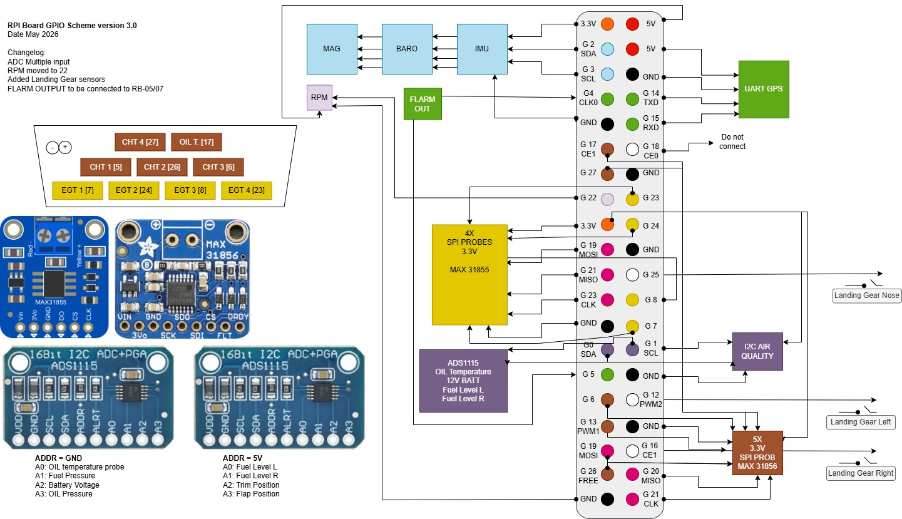

EMS Drivers for the RB-Avionics based on Raspberry Pi
# Setup

## License

RB-Avionics is open source and open design. This repository is dual-licensed by XIAPROJECTS SRL:

1. **GNU Affero General Public License v3.0** (`AGPL-3.0-only`): the community edition, free for all
   builders and personal use. The full text is in [LICENSE](LICENSE). If you distribute this software or a
   modified version, or let others use a modified version over a network, you must offer them its
   complete source code under the same licence.
2. **Commercial licence** from XIAPROJECTS SRL, for products and services that cannot meet the
   AGPL-3.0 terms, for example closed-source devices, firmware or services. Ask through
   [www.rbavionics.com](https://www.rbavionics.com) or the [Discord community](https://discord.gg/G4u6kjmrUG).

Copyright © 2025-2026 XIAPROJECTS SRL.
